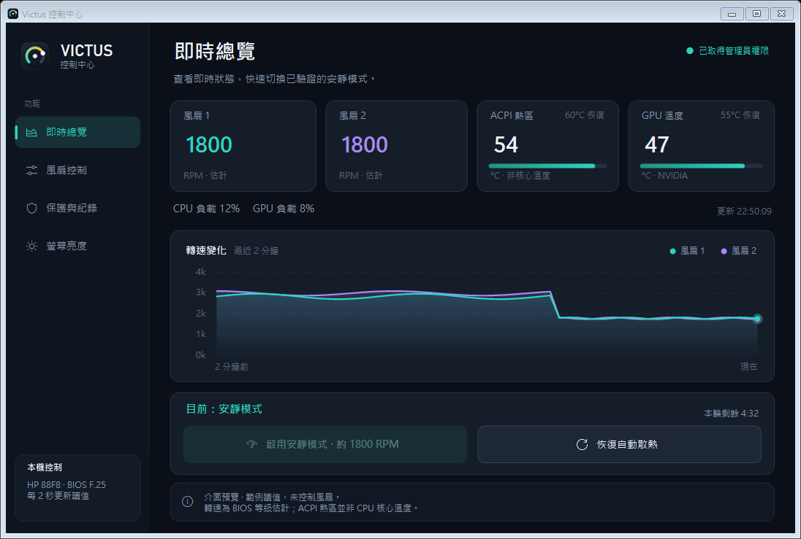
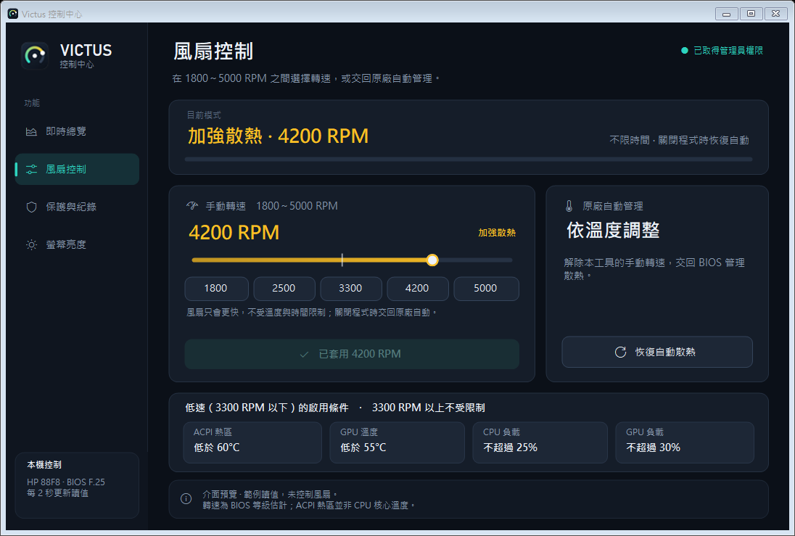

# Victus Control Center

針對特定 HP Victus 筆電製作的 Windows 桌面控制中心：可在 1800～5000 RPM 之間手動設定風扇轉速並隨時交回原廠自動散熱，以及內建／外接螢幕的亮度調整。

> 原名 Victus Fan Control Panel（`victus-fan-control-panel`），v0.2 加入螢幕亮度後改名；舊網址會自動轉到這裡。執行檔名稱仍為 `VictusControlPanel.exe`。

**實驗性、機型限定工具。** 目前只允許主機板 **88F8／BIOS F.25** 啟用風扇控制（螢幕亮度不限機型）。已短暫實測的配置為 HP Victus 16-d0xxx、Intel Core i5-11400H、NVIDIA RTX 3060 Laptop GPU；不代表其他同系列配置均已驗證。這不是 HP 官方軟體。

[下載最新版本](https://github.com/baka2496/victus-control-center/releases/latest) · [回報問題](https://github.com/baka2496/victus-control-center/issues) · [MIT 授權](LICENSE)






*畫面使用範例讀值與範例螢幕，未執行硬體控制。*

## 功能

- 即時顯示兩個風扇的估計轉速、ACPI 熱區、GPU 溫度與 CPU／GPU 負載。
- 顯示最近兩分鐘的轉速曲線。
- 手動轉速 1800～5000 RPM（每 100 一級），以滑桿或快速按鈕選擇：
  - **3300 RPM 以下（低速）**：只看溫度，低溫才能啟用（負載不限制）；每五分鐘重新檢查一次，仍符合條件就自動續轉。
  - **安靜曲線**：低速期間變熱時，先小幅加速到 2200～3200 RPM，降溫後自動降回；到硬性上限才交回原廠自動。
  - **3300 RPM 以上（加強散熱）**：只會讓風扇更快，溫度高時也可使用、不限時間；讀值失效或風扇未升到目標時恢復自動。
- 即時總覽提供「安靜 1800」「最大散熱 5000」「恢復自動」快捷按鈕；條件不符時按鈕停用並說明原因。
- 隨時恢復自動散熱，正常關閉時也會先恢復。
- 溫度、負載升高或讀值失效時提前恢復散熱；附獨立備援程序。
- 本次操作紀錄與圓形黑白圖示。
- **螢幕亮度**：不需要管理員權限。內建螢幕透過 Windows 亮度控制（WMI），外接螢幕透過 DDC/CI（需在螢幕選單開啟）。可拖曳滑桿、用滾輪或方向鍵每次調 5%，或直接選 25／50／75／100%。

不提供強制停轉、1 RPM、低於 1800 或高於 5000 RPM 的轉速，也不會開機自動套用設定。

## 使用方式

1. 從 [Releases](https://github.com/baka2496/victus-control-center/releases/latest) 下載 `VictusControlPanel.exe`，或下載可攜 ZIP。
2. 開啟程式，按「取得管理員權限」，完成 Windows 權限提示。
3. 到「風扇控制」選轉速後按「套用」（低速需低負載、低溫），或在即時總覽按快捷按鈕。需要交回原廠管理時按「恢復自動散熱」。
4. 要調亮度時，切到「螢幕亮度」分頁；接上或拔掉螢幕後按「重新偵測」。亮度直接寫入螢幕，關閉程式後仍會保留。

開啟程式本身不會套用轉速。無效讀值或不符機型時，控制會停用。單一執行檔可直接使用，不會安裝驅動、服務或開機啟動項目，也不修改 BIOS 的 Fan Always On。

需要 Windows 11 x64、現有 NVIDIA 驅動中的 NVML，以及 .NET Framework 4.8 或更新的 4.x 版本。介面目前為繁體中文。程式未經數位簽章。

## 已知限制與恢復條件

轉速來自 BIOS 等級估計，**不是獨立轉速計測量**。ACPI 熱區也**不等於 CPU 核心溫度**。目前完成短暫降速與恢復測試，尚未完成長時間散熱驗證。

啟用低速（3300 RPM 以下）前，須讀到有效資料，且 ACPI 熱區低於 72°C、GPU 低於 67°C；CPU／GPU 負載只顯示，不影響啟用或恢復。加強散熱（3300 RPM 以上）只需有效讀值。

低速期間的安靜曲線：取 ACPI 熱區與「GPU 溫度＋5°C」較高者，60°C 起 2200、64°C 起 2600、68°C 起 2900、72°C 起 3200 RPM；降溫 3°C 以上才降一級。曲線上限 3200 RPM，不會進入加強散熱區。操作紀錄另存於 `%LOCALAPPDATA%\VictusControlCenter\紀錄.txt`。

實機已驗證 1800（安靜）、4200 與 5000 RPM：4200 RPM 時兩個風扇回報約 3800／4000 RPM（仍在上升中），5000 RPM 時約 4600／4700 RPM，並成功交回自動。其他等級使用相同的 BIOS 指令，但未逐一實測。管理員權限下可執行 `VictusControlPanel.exe --verify-levels 結果.txt` 自行驗證。

低速期間遇到下列條件時，會嘗試恢復原廠自動散熱：

- ACPI 熱區達 75°C 或 GPU 達 70°C。
- 監測失效、風扇 20 秒後仍未維持設定轉速（±300 RPM），或每五分鐘檢查時已不符合啟用條件（符合就續轉下一輪）。
- 正常關閉程式。

獨立備援程序會監看主程式與心跳，異常時先寫入正轉等級，再送出 Balanced／BIOS 自動控制交接指令；交接失敗時會嘗試更高風量。這些是保守的應用程式設定，不是 HP 公布的安全上限，也不能保證每種故障下都能恢復。遇到恢復錯誤時，請依面板訊息重試，並使用原廠工具確認散熱狀態。

## 建置

不需要安裝 .NET SDK 或 NuGet 套件。於 Windows PowerShell 或 PowerShell 執行：

```powershell
.\build.ps1
```

輸出位於 `artifacts/VictusControlPanel.exe`。編譯使用 Windows .NET Framework 的 C# 編譯器，將警告視為錯誤。

若要重新產生圖示：

```powershell
.\tools\New-AppIcon.ps1
```

## 測試

```powershell
.\test.ps1
```

測試包含十九項控制行為（含可調轉速的範圍限制、低速保護、安靜曲線與遲滯、負載不影響低速、加強散熱不限時與切換等級）、六項螢幕亮度邏輯（名稱比對、百分比換算），以及七種尺寸的 Windows 原生圖示透明度檢查，**不調整硬體轉速，也不改變螢幕亮度**。

若要在實機確認亮度控制，可另外執行 `artifacts\tests\Display.Tests.exe --hardware`：會把每個螢幕暫時調暗 10%，讀回確認後再調回原值。測試產物寫入 `artifacts/tests/`，不執行刪除或清理命令。

控制測試涵蓋無效讀值拒絕啟動、監測中斷、溫度／負載升高、五分鐘檢查與自動續轉、恢復失敗及重試、獨立恢復結果，以及風扇未維持目標範圍。獨立備援的程序握手曾於本機驗證；沒有故意讓實機當機來測試恢復。

## 原始碼

| 位置 | 用途 |
| --- | --- |
| `src/QuietCore.cs` | 安靜模式、保護條件、時間限制與恢復狀態 |
| `src/QuietHardware.cs` | 限定機型的 HP WMI 控制、ACPI 與 NVIDIA 讀取 |
| `src/QuietRecovery.cs` | 獨立程序與共享記憶體備援 |
| `src/QuietDisplay.cs` | 螢幕偵測與亮度控制（WMI 內建螢幕、DDC/CI 外接螢幕） |
| `src/QuietDashboard.cs` | Windows Forms 控制中心介面 |
| `src/QuietApp.cs` | 程式入口與單一控制實例 |
| `tests/` | 不操作硬體的測試 |
| `tools/New-AppIcon.ps1` | 圓形圖示與透明遮罩產生器 |

回報問題時，請提供機型、主機板型號、BIOS 版本與錯誤訊息，並移除序號、帳號、私人路徑等資訊。

## 授權與參考

本專案以 [MIT](LICENSE) 授權發布。公開的 HP WMI 協定研究與同型號回報提供了重要參考，詳見 [ACKNOWLEDGEMENTS.md](ACKNOWLEDGEMENTS.md)。本專案沒有附帶第三方驅動或上游工具的執行檔。
