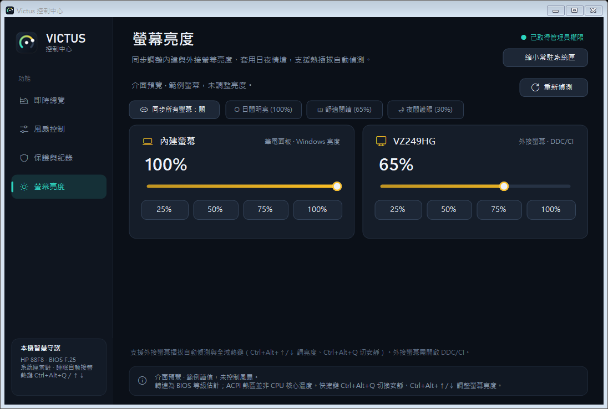

# Victus Control Center

針對特定 HP Victus 筆電製作的 Windows 桌面控制中心：可在 1800～5000 RPM 之間手動設定風扇轉速、搭配智慧安靜曲線與系統匣背景常駐，並提供內建／外接螢幕亮度同步調整。

> 原名 Victus Fan Control Panel（`victus-fan-control-panel`），v0.2 加入螢幕亮度後改名；舊網址會自動轉到這裡。執行檔名稱仍為 `VictusControlPanel.exe`。

**實驗性、機型限定工具。** 目前只允許主機板 **88F8／BIOS F.25** 啟用風扇控制（螢幕亮度不限機型）。已實測的配置為 HP Victus 16-d0xxx、Intel Core i5-11400H、NVIDIA RTX 3060 Laptop GPU；不代表其他同系列配置均已驗證。這不是 HP 官方軟體。

[下載最新版本](https://github.com/baka2496/victus-control-center/releases/latest) · [回報問題](https://github.com/baka2496/victus-control-center/issues) · [MIT 授權](LICENSE)




*畫面使用範例讀值與範例螢幕，未執行硬體控制。*

## 功能

- **即時總覽與互動雙軸趨勢圖**：
  - 即時顯示兩個風扇的估計轉速、ACPI 熱區、GPU 溫度與 CPU／GPU 負載。
  - 左軸顯示雙風扇轉速（RPM 實線），右軸同圖疊加 ACPI 熱區與 GPU 溫度（°C 虛線）。
  - 支援 **2 分鐘／10 分鐘／30 分鐘** 時間範圍切換，**滑鼠移入圖表**可查看十字準線與該秒的詳細轉速與溫度。
  - 提供「安靜 1800」「最大散熱 5000」「恢復自動」快捷按鈕。
- **手動轉速 1800～5000 RPM ＆ 視覺化智慧安靜曲線**：
  - **3300 RPM 以下（低速區）**：只看溫度（**ACPI 熱區＜82°C、GPU＜75°C**；CPU／GPU 負載不限制），每五分鐘重新檢查一次，仍符合條件就自動續轉。
  - **視覺化智慧安靜曲線（3 種模式）**：即時繪製「溫度 vs 轉速」階梯圖，並以**發光圓點**標出目前等效溫度（`Max(ACPI, GPU + 5°C)`）落點。升溫時先小幅加速到 2200～3200 RPM，降溫 3°C 以上才降回一級，避免頻繁切回很吵的原廠模式：
    - **平衡安靜（預設）**：65°C→2200、70°C→2600、74°C→2900、78°C→3200 RPM。
    - **極致安靜**：68°C→2200、73°C→2600、77°C→2900、80°C→3200 RPM。
    - **涼爽安靜**：60°C→2200、65°C→2600、70°C→2900、75°C→3200 RPM。
  - **高溫自動交接與降溫重啟**：達硬性上限（**ACPI 85°C 或 GPU 78°C**）時交回原廠自動散熱；待降溫至 **ACPI ≤ 72°C 且 GPU ≤ 67°C** 時自動重回安靜模式。
  - **3300 RPM 以上（加強散熱）**：只會讓風扇更快，溫度高時也可使用、不限時間；讀值失效或風扇未升到目標時恢復自動。
- **系統匣（System Tray）常駐、開機免 UAC 自動啟動、睡眠自動接管**：
  - 關閉或最小化視窗時可退到右下角系統匣背景守護，小圖示**即時動態顯示溫度與目前模式**，右鍵選單可直接切換風扇模式與螢幕亮度。
  - 支援在「保護與紀錄」分頁一鍵設定 **開機自動背景啟動（透過 Windows 工作排程器最高權限，免跳 UAC 詢問視窗）**。
  - 電腦進入睡眠前主動恢復原廠散熱，喚醒後等待感測器穩定即自動重新接管。
- **螢幕亮度與全域快捷鍵**：
  - 不需要管理員權限。內建螢幕透過 Windows 亮度控制（WMI），外接螢幕透過 DDC/CI（需在螢幕選單開啟）。
  - 支援**外接螢幕插拔自動偵測**、**「同步所有螢幕」連動開關**，以及 **☀ 日間明亮 (100%)／📖 舒適閱讀 (65%)／🌙 夜間護眼 (30%)** 一鍵情境。
  - 全域快捷鍵：**`Ctrl + Alt + Q`** 切換安靜／原廠散熱，**`Ctrl + Alt + ↑ / ↓`** 調整所有螢幕亮度 ±10%。

不提供強制停轉、1 RPM、低於 1800 或高於 5000 RPM 的轉速。

## 使用方式

1. 從 [Releases](https://github.com/baka2496/victus-control-center/releases/latest) 下載 `VictusControlPanel.exe`，或下載可攜 ZIP。
2. 開啟程式，按「取得管理員權限」，完成 Windows 權限提示後即可自動進入安靜守護。
3. 到「風扇控制」可調整目標轉速與安靜曲線模式；需要交回原廠管理時按「恢復自動散熱」。
4. 要調亮度時，切到「螢幕亮度」分頁即可調整或套用日夜情境；亮度直接寫入螢幕，關閉程式後仍會保留。

需要 Windows 11 x64、現有 NVIDIA 驅動中的 NVML，以及 .NET Framework 4.8 或更新的 4.x 版本。介面為繁體中文。

## 已知限制與恢復條件

轉速來自 BIOS 等級估計，**不是獨立轉速計測量**。ACPI 熱區也**不等於 CPU 核心溫度**。

啟用低速（3300 RPM 以下）前，須讀到有效資料，且 ACPI 熱區低於 82°C、GPU 低於 75°C；CPU／GPU 負載只顯示，不影響啟用或恢復。加強散熱（3300 RPM 以上）只需有效讀值。操作紀錄另存於 `%LOCALAPPDATA%\VictusControlCenter\紀錄.txt`，偏好設定存於 `%LOCALAPPDATA%\VictusControlCenter\settings.ini`。

低速期間遇到下列條件時，會嘗試恢復原廠自動散熱：

- ACPI 熱區達 85°C 或 GPU 達 78°C（若開啟自動守護，降溫至 ACPI ≤ 72°C 且 GPU ≤ 67°C 後會自動重回安靜模式）。
- 監測失效、風扇 20 秒後仍未維持設定轉速（±300 RPM），或每五分鐘檢查時已不符合啟用條件（符合就續轉下一輪）。
- 系統進入睡眠，或選擇「結束並恢復原廠散熱」退出程式。

獨立備援程序會監看主程式與心跳，異常時先寫入正轉等級，再送出 Balanced／BIOS 自動控制交接指令；交接失敗時會嘗試更高風量。

## 建置

不需要安裝 .NET SDK 或 NuGet 套件。於 Windows PowerShell 或 PowerShell 執行：

```powershell
.\build.ps1
```

輸出位於 `artifacts/VictusControlPanel.exe`。編譯使用 Windows .NET Framework 的 C# 編譯器，將警告視為錯誤。

## 測試

```powershell
.\test.ps1
```

測試包含二十一項控制行為（含可調轉速的範圍限制、低速保護、三種安靜曲線與遲滯、負載不影響低速、自動降溫重啟、加強散熱不限時與切換等級）、六項螢幕亮度邏輯（名稱比對、百分比換算），以及七種尺寸的 Windows 原生圖示透明度檢查，**不調整硬體轉速，也不改變螢幕亮度**。

## 原始碼

| 位置 | 用途 |
| --- | --- |
| `src/QuietCore.cs` | 安靜模式、三種智慧曲線、保護條件、時間限制與恢復狀態 |
| `src/QuietHardware.cs` | 限定機型的 HP WMI 控制、ACPI 與 NVIDIA 讀取 |
| `src/QuietRecovery.cs` | 獨立程序與共享記憶體備援 |
| `src/QuietDisplay.cs` | 螢幕偵測與亮度控制（WMI 內建螢幕、DDC/CI 外接螢幕） |
| `src/QuietDashboard.cs` | Windows Forms 控制中心介面、系統匣常駐、雙軸圖表、開機排程與熱鍵 |
| `src/QuietApp.cs` | 程式入口與單一控制實例 |
| `tests/` | 不操作硬體的自動化測試 |
| `tools/New-AppIcon.ps1` | 圓形圖示與透明遮罩產生器 |

## 授權與參考

本專案以 [MIT](LICENSE) 授權發布。公開的 HP WMI 協定研究與同型號回報提供了重要參考，詳見 [ACKNOWLEDGEMENTS.md](ACKNOWLEDGEMENTS.md)。本專案沒有附帶第三方驅動或上游工具的執行檔。
